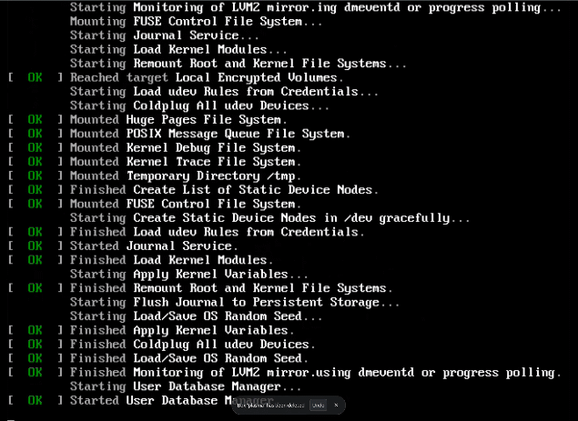

# Optimus Boot
https://github.com/Kauvenix/Optimus-Boot

Switching GPU modes on an NVIDIA Optimus laptop usually means logging in, running commands, and rebooting by hand. Optimus Boot lets you pick a mode from a simple text menu at boot, before the login screen, and applies the change and restarts for you, saving you a login just to switch. Built on top of EnvyControl.

## How it works

<p align="center">
  
</p>

1. `optimus_boot_select_profile` shows a menu on tty8 early in boot.
   Use **Up / Down** and **Enter**. If you press nothing for ~10 seconds, it picks **Current** and boot continues normally.
2. Your choice is written to `/run/optimus-boot.txt`.
3. `optimus-boot` reads it and, if the requested profile differs from the active one, applies it with EnvyControl and **reboots automatically**.

## Requirements

- Linux with systemd
- NVIDIA Optimus laptop
- [EnvyControl](https://github.com/bayasdev/envycontrol), installed system-wide (see below)
- Build tools: a C and C++ compiler, and CMake installed (and whatever `install.sh` needs)


### Installing envycontrol

Optimus Boot requires envycontrol to be installed globally because it runs as a systemd service during boot.

### Install EnvyControl
Requires pipx to be installed

```bash
sudo pipx install --global git+https://github.com/bayasdev/envycontrol.git
ln -s /usr/local/bin/envycontrol ~/.local/bin/envycontrol
```

### Install OptimusBoot

Run the following commands from the OptimusBoot project directory:
```bash
sudo ./install.sh
sudo systemctl enable optimus-boot.service
sudo systemctl enable optimus-boot-select_profile.service
```
rebooting is recommended

### Uninstall OptimusBoot:
```bash
sudo systemctl disable --now optimus-boot.service
sudo systemctl disable --now optimus-boot-select_profile.service
sudo rm "/usr/bin/optimus-boot"
sudo rm "/usr/lib/systemd/system/optimus-boot.service"
sudo rm "/usr/bin/optimus_boot_select_profile"
sudo rm "/usr/lib/systemd/system/optimus-boot-select_profile.service"
sudo systemctl daemon-reload
```

## Notes
- Changing the profile always triggers a reboot.
- Tested on: EndeavourOS Titan Nova and Solus Linux.

## Contributing & Support

Found a bug or have a suggestion? [Open an issue](https://github.com/Kauvenix/Optimus-Boot/issues).
Please include your distro, GPU, and the output of:

```bash
journalctl -b -u optimus-boot.service -u optimus-boot-select_profile.service
```

Pull requests are welcome.

## Author

Made by [Kauvenix](https://github.com/Kauvenix).

## Credits

Built on top of [EnvyControl](https://github.com/bayasdev/envycontrol) by bayasdev.

## License

Released under the <MIT> License. See LICENSE.
